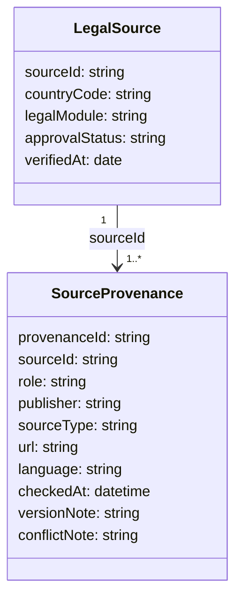

# 法律数据多源溯源：设计

## 实体与关系

`role=primary` 仅用于适用法域的官方法源、官方公报、主管机关、法院或仲裁机构正式资料；`role=cross_check` 用于独立核验版本、办理路径或国际规则。每个资料条目恰有一个主来源。

## 数据与接口

- 新表 `legal_source_provenance` 外键关联 `legal_sources.source_id`。
- 管理端可查看草稿资料的全部来源；普通检索只返回已审核资料的来源元数据。
- 审核动作在服务层校验：主来源、核验时间、适用前提、不能推断内容和人工复核触发条件均存在；存在未解决冲突时拒绝通过。

## 安全与迁移

- 现有 `source_url` 回填为每条旧资料的 `primary` 来源，迁移不修改其审核状态。
- 新来源默认 `draft`，不参与 RAG。
- 不保存访问凭据、受限数据库内容或未获授权的全文。

## 验证

迁移后检查：旧条目仍可检索；草稿不能检索；缺主来源不能审核通过；同一条目可显示多个来源；国家/模块隔离保持有效。
